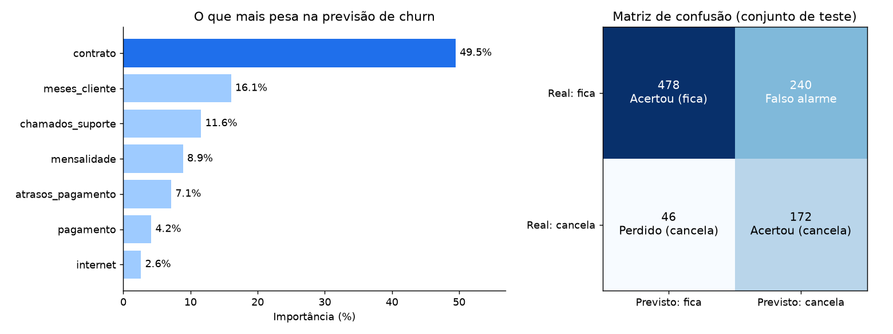

# Previsão de churn de clientes com Databricks, Delta Lake e Spark MLlib

Atividade de Ciência de Dados: pipeline completo de ingestão, ETL e classificação em uma operadora de telecom fictícia, com leitura dos resultados para o negócio.

**Instituição:** Católica de Santa Catarina

**Disciplina:** Ciência de Dados

**Professor:** Claudinei Dias (Ney)

**Autor:** José Henrique Brühmüller.

## Trabalho principal

Abra **[notebooks/churn_databricks.py](notebooks/churn_databricks.py)**, um notebook no formato de código-fonte do Databricks (importe pelo menu **Import** do workspace). Ele contém as quatro etapas pedidas, com comentários e a interpretação de negócio.

**Problema:** prever quais clientes vão cancelar o contrato (`churn`) para que a retenção atue antes da saída, em vez de campanhas em massa.

## Dados e metodologia

- Fonte: dataset **sintético** gerado por [gerar_dados.py](gerar_dados.py) (semente 42), com 5.000 clientes e 9 colunas: tempo de casa, contrato, internet, forma de pagamento, mensalidade, chamados de suporte, atrasos e `churn`. Não são dados reais de nenhuma empresa.
- **Ingestão:** `spark.read.csv()` e `df.write.saveAsTable("churn_clientes_bronze")` (tabela Delta no Databricks).
- **Tratamento (ETL):** `dropna()` e `dropDuplicates` (106 linhas removidas, 4.894 restantes, tabela `churn_clientes_silver`); `StringIndexer` e `OneHotEncoder` nas categóricas; `VectorAssembler` e `StandardScaler`, tudo em um `Pipeline` do MLlib.
- **Treinamento:** `randomSplit([0.8, 0.2], seed=42)`, com 3.958 linhas de treino e 936 de teste. `RandomForestClassifier` com 150 árvores e profundidade 8. Como só 23% dos clientes cancelam, a classe churn recebe peso 3,28 (`weightCol`).
- **Avaliação:** AUC, acurácia, F1, matriz de confusão e importância das variáveis. As predições ficam na tabela `churn_clientes_gold_predicoes`.

## Resultados da execução

Resultados no conjunto de teste (936 clientes, 218 deles com churn):

| Métrica | Valor |
|---|---:|
| AUC | 0,773 |
| Acurácia | 0,694 |
| F1 (ponderado) | 0,718 |
| Recall do churn | **0,789** |
| Precisão do churn | 0,418 |

| | Previsto: fica | Previsto: cancela |
|---|---:|---:|
| **Real: fica** | 478 | 240 |
| **Real: cancela** | 46 | 172 |



## Interpretação para o negócio

- **Quem cancela:** o tipo de contrato responde por cerca de metade da importância do modelo, com o contrato mensal à frente, seguido de tempo de casa (clientes novos saem mais), chamados de suporte e atrasos de pagamento. Forma de pagamento e tipo de internet pesam pouco.
- **Ação operacional:** ordenar a fila da retenção pela probabilidade de churn. Abordar 44% da base (412 de 936) captura 79% dos cancelamentos, cerca de 1,8 vez mais que uma seleção aleatória. Migrar clientes do contrato mensal para o anual, com desconto, ataca o principal fator.
- **Impacto:** a retenção passa de campanha em massa para ação focada. Para dimensionar o retorno, compare o desconto concedido aos 240 falsos positivos com a receita preservada pelos 172 verdadeiros positivos.
- **Equilíbrio:** sem o balanceamento de classes, o recall do churn era de 15% (33 de 218), com acurácia aparente maior. Priorizamos recall porque deixar um cancelamento passar custa mais que um contato desnecessário.

**Limitações:** os dados são sintéticos e o sinal foi construído por regras simples, então os números não valem para uma operadora real. Há um único split, sem validação cruzada nem ajuste de hiperparâmetros, e o limiar de decisão é o padrão de 0,5.

## Executar no Databricks

1. Crie um workspace gratuito ([Databricks Free Edition](https://docs.databricks.com/aws/en/getting-started/)).
2. Em **Catalog**, crie um Volume (por exemplo `workspace.default.churn`) e envie `dados/churn_clientes.csv`.
3. Em **Workspace > Import**, importe `notebooks/churn_databricks.py`.
4. Confira o `CAMINHO_CSV` na primeira célula de código e use **Run all** em um compute serverless.

## Executar localmente (opcional)

Requer Java 17 ou superior e, no Windows, WSL ou Linux (o Spark precisa do `winutils` no Windows nativo).

```bash
python -m venv .venv && source .venv/bin/activate
pip install -r requirements.txt
python executar_local.py
```

O script roda o mesmo notebook e grava as métricas em `resultados/`. Localmente as tabelas são Parquet; Delta Lake é o formato padrão apenas no Databricks. Os números podem variar um pouco entre versões do Spark.

## Arquivos

| Arquivo/pasta | Conteúdo |
|---|---|
| `notebooks/churn_databricks.py` | Notebook Databricks com ingestão, ETL, treino e interpretação. |
| `dados/churn_clientes.csv` | Dataset sintético (5.000 clientes, com nulos propositais). |
| `gerar_dados.py` | Gerador do dataset, com semente fixa. |
| `executar_local.py` | Execução local com PySpark e exportação dos resultados. |
| `resultados/metricas.json` | Métricas, contagens de linhas e versões do ambiente. |
| `resultados/matriz_confusao.csv` | Matriz de confusão no teste. |
| `resultados/importancia_variaveis.csv` | Importância de cada variável do Random Forest. |
| `resultados/graficos_resultados.png` | Gráficos de importância por variável e matriz de confusão. |
| `requirements.txt` | Dependências da execução local. |

## Acesso ao projeto

- **Repositório:** https://github.com/JHBruhmuller/databricks-churn-clientes
- **Notebook:** https://github.com/JHBruhmuller/databricks-churn-clientes/blob/main/notebooks/churn_databricks.py

## Referências

- Databricks. **Getting started**. https://docs.databricks.com/aws/en/getting-started/
- Apache Spark. **MLlib: Main Guide**. https://spark.apache.org/docs/latest/ml-guide.html
